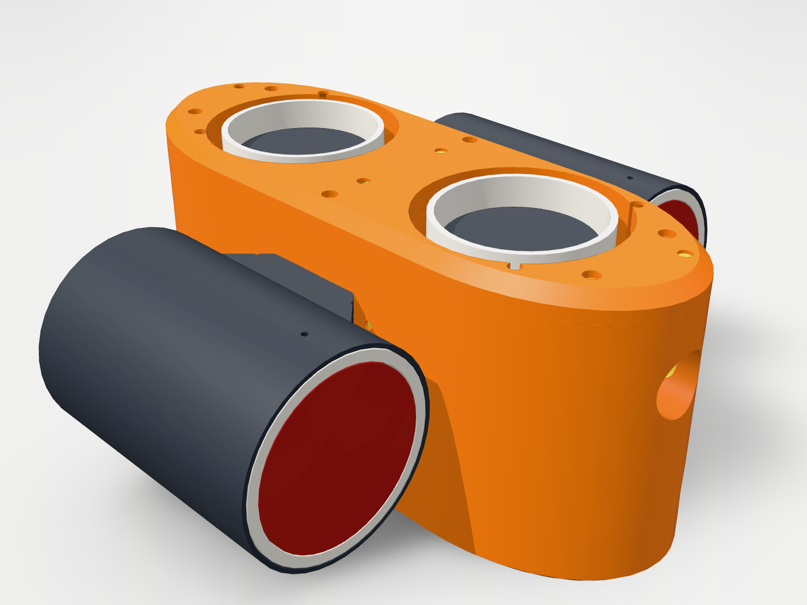

# Aqua Bots v14: streamlined ROV hull

A new hull for the team's 4 thruster pods: the modified SEAFLO 1100 GPH pumps (strainer removed, 55 mm prop) in the
team's "motor caseing v1" print. The thruster layout is the same as before (2 vertical, front and rear; 2 side), so
`rov.py` and the controller profiles work unchanged apart from one setting (see **Software**).

- **Size:** 250 x 247 x 130 mm (the old frame was 248 x 269 x 69 plus the pods sticking out).
- **Weight:** about 2.45 kg ready to dive.
- **Buoyancy:** slightly positive (+15 g), so it floats up gently if anything fails.

## What the tests showed

These are simulations of the design. Real pool numbers will differ: see **Assumptions**.

| Test | v14 (new) | v13 (old frame) |
|---|---|---|
| Top speed forward | **1.38 m/s** | 0.80 m/s |
| Reverse | **1.15 m/s** | 0.67 m/s |
| Forward drag area (Cd x A) | **0.010 m2** | 0.031 m2 |
| Pitch at full forward | +0.4 deg (stays level) | +0.8 deg |
| Pitch while rising | -0.8 deg | +2.5 deg |
| Up / down speed | 0.75 / 0.61 m/s | 0.75 / 0.61 m/s |
| Turn radius (full forward, half turn) | 0.19 m | 0.23 m |
| Tilt stick at 40 / 60 / 100 % | 16 / 25 / 44 deg, never loops | - |
| Rights itself from upside down | 1.6 s | - |
| Rights itself from on its side | 0.5 s | - |
| Centre of buoyancy above centre of gravity | 11.4 mm | - |

**Strength.** A nacelle carrying twice the whole robot's weight (lifting it by one nacelle) gives a safety factor of 1.7
in PETG and 1.5 in PLA. A 71 N fore-and-aft knock gives 5.2 (PETG) and 4.4 (PLA). The pods inside make the nacelles
stiffer still. This is a linear static check, not an impact test, so don't throw it.

**Printability.** Every part passes the FDM check for an H2S with no supports. The hull print has about 3 cm3 of
sagging overhang at 45 degree chamfers, which the slicer handles.

Both **PETG and PLA** work. PETG is better for repeated pool use; PLA is fine for a season. The ballast changes by
about 10 g between them.

## Files

| File | What it is |
|---|---|
| `print/petg/rov_v14_PETG.gcode.3mf` | **Ready to print**: whole set, one plate, H2S, Bambu PETG HF, 0.20 mm, Textured PEI. 327 g, 8 h 52 min |
| `print/pla/rov_v14_PLA.gcode.3mf` | Same in Bambu PLA Basic. 332 g, 8 h 45 min |
| `3MF/*.3mf`, `STL/*.stl` | Each part on its own, already turned the right way up for printing |
| `STEP/` | Each part plus the whole assembly, for any CAD program |
| `DXF/foam_template_*_1to1.svg` | Foam cutting templates. Print at 100 % scale (they are in mm) |
| `rov_v14.sc` | The SolidCraft version (open in SolidCraft). Bodies HullTub, HullCap, Nacelle_L, Nacelle_R, within 0.6 % of the print files. Parameters TX, B, NOSE_A, H, CH, SKIN, CAP_H, TUN_ID, TUN_WALL, NAC_WALL, POD_L, BOSS_R, FLOOD_D drive the hull, tunnels and nacelle tube; hole, boss and camera positions are fixed numbers in their sketches |
| `src/` | The text-to-cad model (`params.py` holds every dimension) |
| `analysis/` | The simulation (`sim.py`, results in `sim_petg.txt` / `sim_pla.txt`), mass properties, strength studies (`fea/`, with stress pictures) |
| `docs/` | Pictures and a 3D view of the assembly (`rov_v14.glb`) |
| `ref/` | The old v13 frame and the motor casing, for comparison |

**To rebuild the models:** install [text-to-cad](https://texttocad.dev), then `cad run src/rov.py` and `cad run src/print_parts.py`. The simulation is `cad run analysis/sim.py` (`--pla` for PLA).

## Print settings

Open the `.gcode.3mf` in Bambu Studio and send it. To slice it yourself, these are the settings that matter:

| Setting | Value |
|---|---|
| Printer | Bambu Lab H2S, 0.4 mm nozzle |
| Profile | 0.20 mm Standard |
| Walls | 2 |
| Infill | **100 %**, zig-zag |
| Supports | Off |
| Plate | Textured PEI |
| Brim | Auto |

Use **100 % infill** for every part. Air trapped in sparse infill leaks out slowly underwater, so the buoyancy keeps
changing and the trim drifts. The walls are only 2 to 4 lines thick anyway, so 100 % costs almost nothing.

**Orientation:**

- **Hull tub:** floor down.
- **Hull cap:** roof down.
- **Nacelles:** stood on end. Print **2**.

## Parts list

| Qty | Part | Use |
|---|---|---|
| 1 | hull_tub, hull_cap | printed |
| 2 | nacelle | printed (the same part both sides, the right one turned over) |
| 6 | M3 x 16 self-tapping (or machine) screw | cap to tub |
| 8 | M3 x 12 screw + M3 nut | nacelles to hull |
| 6 | M3 x 8 self-tapping screw | stop the pods sliding out (1 per tunnel, 2 per nacelle) |
| about 1 L | closed-cell foam: XPS insulation board (pink/blue), 20 or 25 mm | buoyancy. **Not** polystyrene beads (they soak up water) and not pool noodle (it crushes) |
| about 300 g | steel nuts / washers (M6-M10) or lead fishing sinkers | ballast |
| | epoxy or hot glue, zip ties, marine grease | |

## Build

1. **Pods.** Slide a vertical pod into each tunnel, **prop duct up, motor end flush with the bottom**. Fix each with an
   M3 x 8 self-tapper through the small hole in the tunnel wall (inside the middle compartment) into the pod's sleeve.
2. **Side pods.** Slide each side pod into a nacelle **prop duct forward**. Fix them with M3 x 8 screws through the top
   and bottom holes near the front. Prop-forward puts the heavy motor at the back, which balances the camera in the nose.
3. **Nacelles to hull.**
   - Drop an M3 nut into each of the 4 slots in each nacelle's bolt bosses.
   - Bolt the nacelle to the hull side from inside the hull with M3 x 12 screws.
   - Run the pod wires through the 8 mm hole in the middle of the joint into the hull.
4. **Wiring.**
   - Vertical pod wires enter through the 8 mm holes in the tunnel walls.
   - All the wires and the camera cable leave through the tether tube in the tail.
   - Put a cable tie round the tether just inside the tube so a pull on the tether doesn't pull the wires.
5. **Camera.** The nose bay takes a camera up to 24 mm across and 26 mm long, looking forward.
   - A different camera means a different `CAM_D` / `CAM_DEPTH` in `params.py`, or in the SolidCraft parameters.
   - The camera must be waterproof itself: the hull floods.
6. **Ballast.** The bottom 14 mm of the hull is the ballast bay. Start with about **25 g in the front bay** and
   **about 235 g in the middle bay**, nothing in the rear. Glue or zip-tie it down.
7. **Foam.** Cut the foam to the templates and fill the hull above the ballast.
   - **Main block:** about 103 mm tall, stacked from sheets. Leave the tunnels, bosses and camera bay clear (the
     template shows the outline at mid-height).
   - **Cap sheet:** about 8 mm, glued into the cap.
   - Rounding a few mm off the foam edges makes it slide in.
8. **Cap.** Screw the cap on with the 6 M3 x 16 screws.

**The hull is meant to flood.** Water comes in through the holes in the floor and roof; the foam does the floating.
Don't seal it.

## Trimming in the pool (do this once)

1. Put it in the water with the motors off.
2. **It should float up slowly**, about 10 cm/s, and sit level. Then add or remove steel in the bays:
   - **Shoots up:** add ballast to the middle bay.
   - **Sinks:** take ballast out, or add a little foam.
   - **Nose down:** move ballast from the front bay to the rear bay.
   - **Nose up:** move ballast from the rear bay to the front bay.
3. **The tether** pulls the tail. Tape small floats on the tether near the robot until it hangs neutral.

The numbers above assume each modified pump weighs about 300 g. Weighing one pod before the build makes the first
trim close: if the pod is heavier than 450 g, expect less ballast; if lighter, more.

## Software (one setting)

The new hull is stable but light on pitch. At the old tilt strength, full tilt makes it loop over. On the Pi or
laptop, edit `config.toml` (it is kept through updates):

- **Front-up motor:** change `pitch = 1.0` to `pitch = 0.4`.
- **Rear-up motor:** change `pitch = -1.0` to `pitch = -0.4`.

Leave the other motors as they are. Full tilt is then about 44 degrees and it springs back level when you let go.

**Side thrusters.** If the side thrusters push it backwards after the change to prop-forward, use SETUP > MOTORS >
FLIP on motors 3 and 4. Each prop pushes harder one way. The side ones should push forward in their strong direction,
so swap the prop round if needed.

## Assumptions (what to measure to make the numbers exact)

| Assumption | Used | How to check |
|---|---|---|
| Pump motor (strainer removed) | 300 g, displaces 184 cm3 | Weigh one pod in air and hanging in water |
| Thrust per thruster | 5.0 N forward, 3.5 N reverse | Pull against a luggage scale in the pool |
| Camera | 35 g | Weigh it |
| Drag coefficients | 0.30 hull, 1.2 old frame, 0.8 pods | Measure top speed over 5 m in the pool |
| Steady water, no tether pull | | |

The speeds scale with thrust: 20 % less thrust means about 10 % less speed, for both designs. The comparison between
old and new holds either way.
