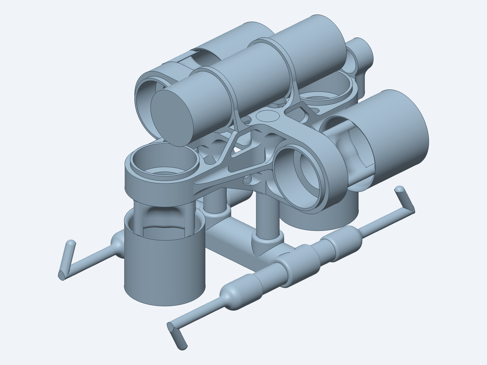
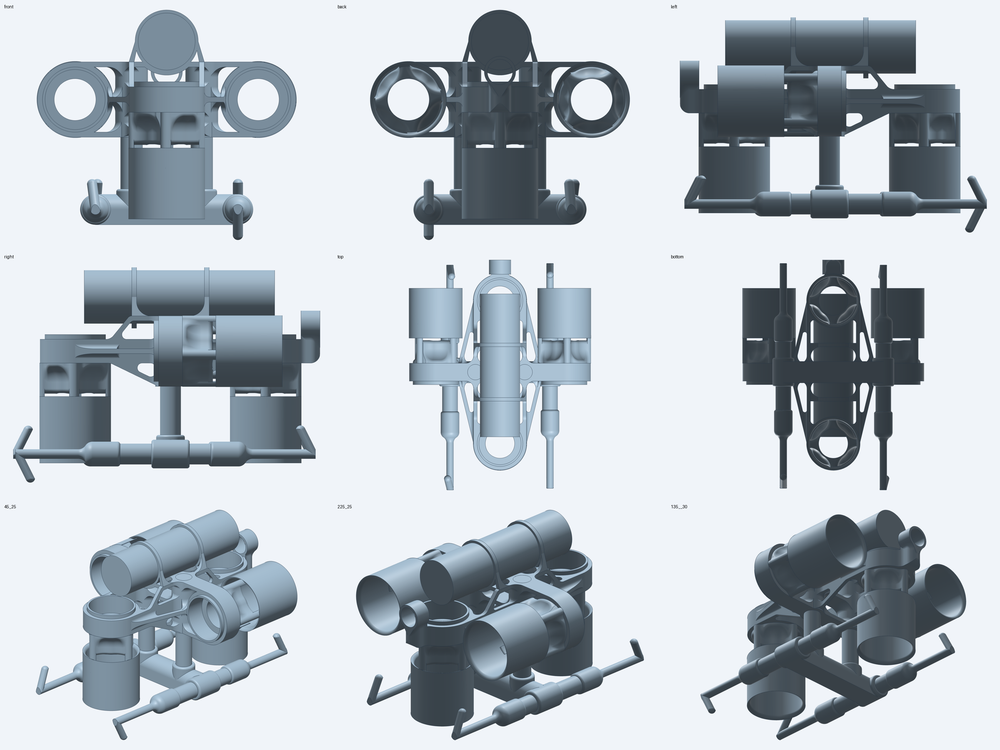

# Aqua Bots ROV: the new frame (pool noodle on top)

Our own design, made in Onshape: the v13 X-shaped frame with a pool noodle on top, four of our motor holsters and a
printed skid underneath. Every part except the noodle is printed separately.

| | |
|---|---|
| Printed parts | frame, 4 motor holsters, skid (all printed separately) |
| Size | 255 × 322 × 226 mm with the skid; the frame alone is 254 × 294 × 125 mm and fits the H2S plate |
| Float | 1 pool noodle on top, 56 mm (see [Noodle length](#noodle-length): it needs to be about 300 mm) |
| Motors | modified SEAFLO SFBP1-G1100-01 1100 GPH pumps: 2 side (forward/back), front and rear (up/down) |
| Software | pick **NEW FRAME** on SETUP › EXTRAS › FRAME (in [underwater-rov](https://github.com/codemastervy/underwater-rov)) |

The earlier designs are kept on their own branches: [`v15-open-frame`](../../tree/v15-open-frame),
[`v16-classic`](../../tree/v16-classic), [`v17-v13-shape`](../../tree/v17-v13-shape),
[`v14-flooded-hull`](../../tree/v14-flooded-hull).

## Before you print: 3 things

1. **Drill drain holes** (about 3 mm) in the frame, the holsters and the skid. At 15 % gyroid the inside is mostly
   air. Water seeps in during a run, so without holes the robot starts out floating (+340 g, nose down 11°) and gets
   heavier as it fills. It can also get stuck on its side. With drain holes they fill straight away and it weighs
   the same on every dive.
2. **Make the noodle about 300 mm long** (the model has 200 mm). With 200 mm and flooded parts it **sinks** (−235 g).
3. **Re-export the skid** from Onshape as one joined part (Boolean union). In this STL its pipes and fittings
   overlap without being joined, and some pieces aren't closed. Bambu Studio patches it to slice, but the printability
   check fails it.

## Print it

Sliced files (Bambu H2S, 0.4 nozzle, 0.20 mm, **15 % gyroid**, 3 walls, tree supports, Textured PEI):
`print/petg/` and `print/pla/`. To slice yourself use `design/parts/*.stl` with `print/process.json`.

| Part | Qty | PETG | PLA | Time each (PETG) |
|---|---|---|---|---|
| Frame (`frame.stl`) | 1 | 280 g | 279 g | 11.0 h |
| Motor holster (`pod_*.stl`) | 4 | 113 g | 114 g | 3.2 h |
| Skid (`skid.stl`) | 1 | 206 g | 208 g | 7.6 h |
| **Total** | | **936 g** | **941 g** | **about 31.5 h** |

Weights include supports. Without supports the frame would print 49 mm bridges and flat undersides in mid-air.

**Printability check** (`analysis/results/print_check.txt`):

* **Frame:** passes, 1 solid, walls 3–5 mm. Print it upright as exported (the best of 6 orientations) with
  supports: 13 overhangs and 10 bridges need them.
* **Holster:** passes, but the thinnest wall is 1.0 mm and one edge is knife-sharp. Lay it on its flat end.
* **Skid:** **fails**: 14 places where the surface passes through itself (see point 3 above).

## How it behaves (simulation)

6-DOF simulation (`analysis/sim.py`; it models buoyancy, drag on every part, added mass and thruster lag).
PETG, 15 % gyroid parts flooded (drain holes), 56 × 320 mm noodle, motor trim from the software (NEW FRAME):

| | New frame |
|---|---|
| Floats | +52 g (slightly positive: it rises slowly if anything fails) |
| Centre of buoyancy above the centre of gravity | 28 mm |
| Sits at rest | level (pitch −4°, roll 0°) |
| Forward / reverse | 0.58 / 0.49 m/s, within 2° of level |
| Up / down | 0.49 / 0.38 m/s, within 5° of level |
| Spin / turn radius | 266 °/s / 0.22 m |
| Tilt stick 40 % / 100 % | holds 13° / 25° |
| Upright from on its side / upside down / nose down | 0.4 s / 1.2 s / 0.5 s |

PLA is the same within 1 % (`analysis/results/pla_flooded_320_trim.txt`).

**Other cases** (all in `analysis/results/`):

| Case | Floats? | Notes |
|---|---|---|
| As drawn: 200 mm noodle, parts flooded | **sinks, −235 g** | needs about 100 mm more noodle |
| As drawn: 200 mm noodle, air sealed in the parts | +341 g | nose down 11°; **can't right itself from its side**; heavier as it floods |
| 320 mm noodle, motors untrimmed (v13 settings) | +52 g | tilts 27° at full forward; **a full tilt stick flips it over** |
| 360 mm noodle with a 20 mm hole | +38 g | same as the 320 mm solid noodle |

### Software trim (NEW FRAME)

| Setting | Value | Why |
|---|---|---|
| Tilt power | 0.25 | it rights itself gently; at 1.0 a full tilt stick loops it |
| Front up motor | 0.75 | it climbs and dives level |
| Rear up motor | 1.00 | |
| Level when driving | 0.30 | the side motors sit above the weight, so it would tilt 27° when driving |

Fine-tune these in the pool with **TRIM ▸** (SETUP › DESIGN).

### Noodle length

Each 1 mm of a 56 mm noodle lifts 2.4 g (2.1 g if it has a 20 mm hole). With flooded parts:

* **solid noodle: about 300 mm** (320 mm floats +52 g)
* **noodle with a 20 mm hole: about 350 mm**

Cut it a little long and trim in the pool: **sinks** → longer; **shoots up** → shorter (aim for a slow rise, about a
hand-length every 2 s); **nose down** → slide it forward; **nose up** → slide it back.

## Assumptions to check

* Each motor weighs 300 g in air and about 116 g in water (SEAFLO 1100 with the strainer cut off). **This is the
  biggest unknown.** Hang a motor from a kitchen scale into a bucket of water and update `pump_motor_kg` in
  `analysis/sim_core.py`.
* Thrust 5 N forward / 3.5 N reverse per motor.
* Pool noodle foam 30 kg/m³; camera 35 g at the front; wiring 60 g.
* Forward is the end without the small tether ring.

## Files

| Path | What |
|---|---|
| `design/aqua_bot_v13-.stl` | the whole design as exported from Onshape |
| `design/parts/` | each part on its own: `frame`, `pod_left/right/front/rear`, `noodle`, `skid` |
| `print/` | sliced files (`petg/`, `pla/`) and the Bambu presets (`process.json` = 15 % gyroid + supports) |
| `analysis/sim.py` | the simulation: `cad run analysis/sim.py` (options such as `--pla`, `--sealed`, `--noodle-len=300` are listed at the top of the file) |
| `analysis/sim_core.py` | the 6-DOF simulator and the motor/thrust assumptions |
| `analysis/results/` | simulation results for each case and the printability check |
| `docs/` | pictures |
| `ref/` | the old v13 frame and the motor casing |
