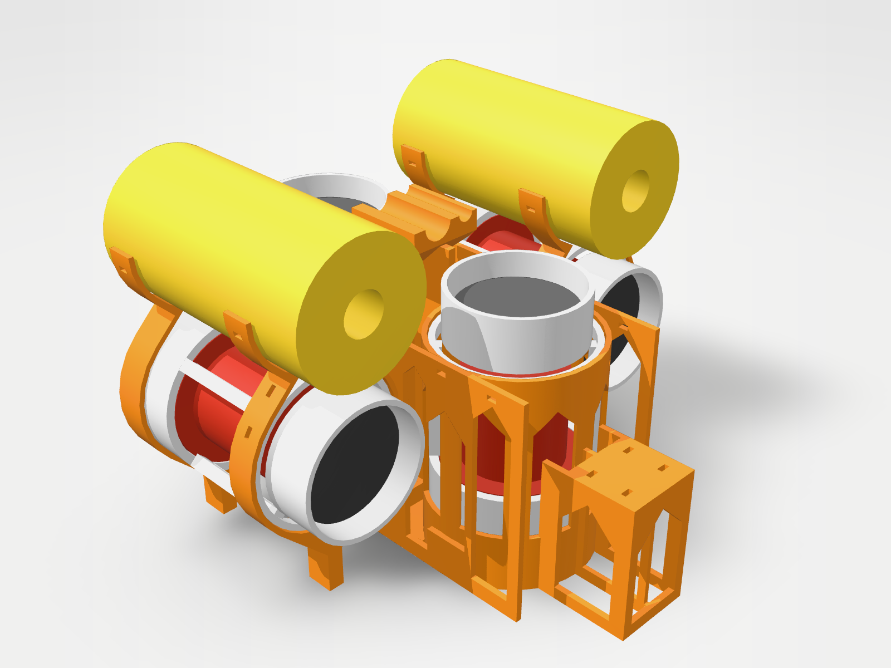
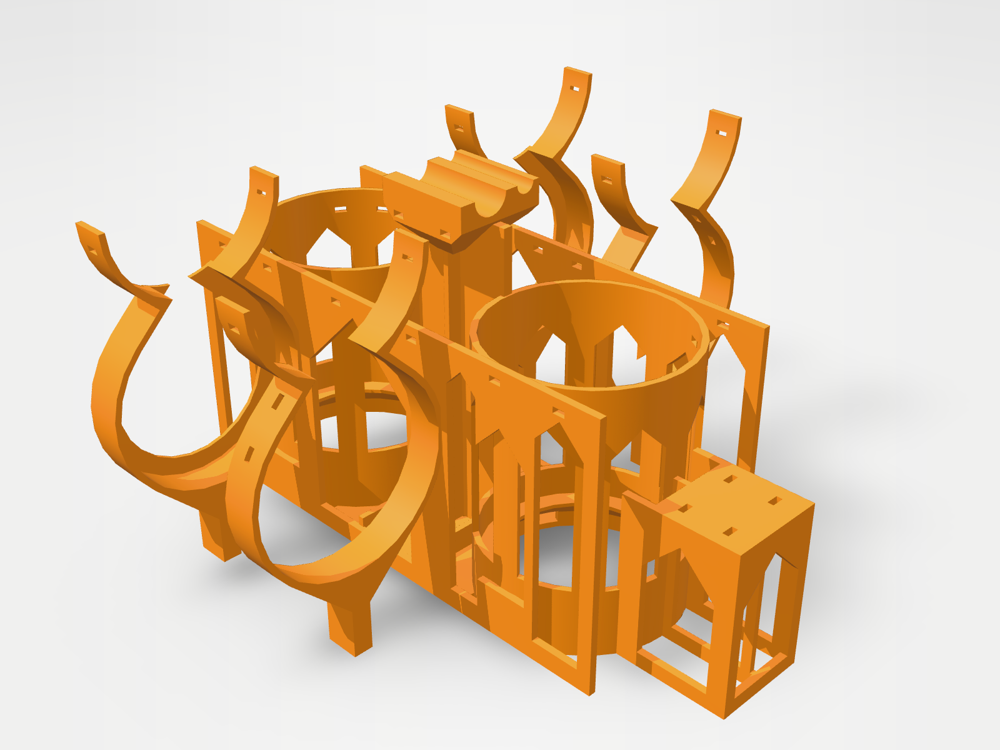

# Aqua Bots ROV v15: open frame + pool noodles

One printed frame, four of our thruster pods, two pieces of pool noodle and a bag of zip ties.
There are no screws, glue, ballast, foam blocks or sealed hull.

It uses the same four thrusters as the current robot: modified SEAFLO SFBP1-G1100-01 1100 GPH bilge-pump motors with
55 mm props, in our "motor caseing v1" print. Motor numbering is unchanged: **1 rear-up, 2 front-up, 3 right, 4 left**.

| | |
|---|---|
| Printed parts | 1 (the frame), 249 × 245 × 146 mm, fits the H2S plate |
| Filament | PETG 382 g or PLA 388 g, about 10.5 h on a Bambu H2S |
| Hardware | about 20 zip ties (2.5 mm wide, 150-200 mm long) |
| Floats | 2 × 126 mm of standard pool noodle (65 mm, hollow) |
| Mass in air | about 2.2 kg with pods, camera and wiring |
| Trim | slightly positive at the surface (+15 g); level; self-rights |

The previous design (v14: flooded streamlined hull with foam and steel ballast) is on the
[`v14-flooded-hull`](../../tree/v14-flooded-hull) branch.

## Why this design

We based it on what already works:

* **Our current robot**: the same 4-thruster layout, the same pods and the same control software (see the change to `config.toml` below).
* **SeaPerch**, the standard school ROV: pool-noodle floats, bilge-pump motors, an open frame, and trimming by sliding the floats.
* **BlueROV2**: an open frame with the buoyancy on top and the weight low, so it rights itself. The tether is clamped to the frame so a pull never reaches the wires.

Pool noodles are the float because we already have them, they cost nothing and they're easy to cut. Trimming is done
in the pool by changing the noodle length and sliding the noodles forward or back. No ballast is needed.

## Print it

Open `print/petg/rov_v15_PETG.gcode.3mf` (or `print/pla/rov_v15_PLA.gcode.3mf`) in Bambu Studio and send it to the printer.
To slice it yourself, use `3MF/frame.3mf` or `STL/frame.stl` with these settings:

| Setting | Value | Why |
|---|---|---|
| Printer / process | Bambu Lab H2S 0.4 nozzle, 0.20 mm Standard | |
| Filament | Bambu PETG HF (best) or PLA Basic | PETG copes better with sun, knocks and water; PLA is fine for pool sessions |
| Plate | **Textured PEI** | Bambu Studio won't put PETG on the Cool Plate |
| Infill | **100 %**, zig-zag (rectilinear) | Thin walls; solid parts don't soak up water |
| Walls | 3 loops | |
| Supports | **off** | Every window has a pointed (45°) top and the pod lips sit on 45° funnels |
| Brim | auto | |
| Orientation | as exported: tray and skirts on the plate | |

The printability check passed with no errors (79 mm² of small overhangs and 16 mm bridges, both fine on an H2S).
Let it cool on the plate before you take it off.

## Build it

### 1. Pods (4 zip ties)
* **Up/down pods (front motor 2, rear motor 1)**: drop in from the top, **prop duct up, motor down**. They sit on a
  lip 14 mm above the table. Under the lip is a skirt with a notch facing the middle of the robot. The motor wires leave
  through that notch, so they aren't pinched under the pod. Put one zip tie through the two slots near the top of the tube
  and around a cage bar of the pod.
* **Side pods (motor 4 left, motor 3 right)**: slide in from the front, **prop duct forward**, until the motor
  sleeve stops on the rear lip. Put one zip tie through the front band's slots and around a cage bar.

### 2. Wiring
* **Splice tray**: the floor between the up/down pods, with low walls and drain holes. Lay the 8 motor-wire-to-tether
  splices (heat-shrunk) here and hold them down with 2 zip ties through the floor slots. They stay low, which helps
  the robot right itself, and they're kept out of the props.
* **Wire clips**: 7 slots along the top of each side rail. Zip-tie the side-pod leads along the rail to the tray.
* **Tether + camera post**: the post in the middle rises to 72 mm with two grooves along the robot. The big groove takes
  the tether (up to 14 mm), the small one the camera cable (up to 7 mm). Put one zip tie through each pair of slots and
  pull it tight. **Leave a slack loop between the post and the tray**: if someone pulls the tether, the post takes the load, not the
  splices. The post is high and central, so a pull doesn't tip the robot nose-down.

### 3. Camera
The shelf at the front (36 × 40 mm, 4 zip-tie slots) is in front of and below the front up/down pod, so the props stay
out of the picture. The bumper in front protects the lens. Zip-tie the camera down and run its cable along the rail
to the post.

### 4. Pool noodles (4 zip ties)
1. Cut **two pieces 126 mm long** from a 65 mm noodle (125 mm for a PLA frame). A bread knife works well. Round or taper
   the ends if you like: it cuts drag a little and makes no difference to the lift.
2. Lay them in the saddles above the side pods, **centred 4 mm behind the middle of the frame** (the piece runs from 67 mm
   behind centre to 59 mm in front).
3. Zip-tie each piece through the two saddle slots. Don't crush the foam.

The saddles take any noodle from 55 to 75 mm. Different noodles float differently, so plan to trim in the pool:

### 5. Trim in the pool (10 minutes)
* **Sinks** → add noodle length (each 1 mm on both pieces ≈ 6 g of lift), or use fatter noodle.
* **Shoots up** → cut the noodles shorter. Aim for it to rise slowly, about a hand-length every 2 s.
* **Nose down** → slide both noodles forward. **Nose up** → slide them back.
* **Leans to one side** → slide that side's noodle outward or make it a little longer.

Noodle foam squashes with depth (about 4% at 1 m, 12% at 3 m). The robot becomes slightly heavy below about 0.5 m
(−15 g at 1 m, −75 g at 3 m), which the up thrusters easily cover. Lose power at depth and it **sinks slowly**,
so pull it back on the tether. In a school pool (≤ 2 m) this doesn't matter.

### 6. Software
Set the pitch mix on the front/rear motors to **±0.4** in `config.toml`, the same as for v14. At full pitch gain
(1.0) a full-tilt stick flips the robot over. At 0.4 a full stick holds about 20° of tilt. Nothing else changes.
(The autopilot stays off the controller, as before.)

## How we know it works

All numbers below come from simulation and analysis, not a pool test yet. Weigh one pod and test it in the pool before you trust them.

**6-DOF simulation** (`analysis/sim.py`; it models buoyancy, drag on every part, added mass and thruster lag):

| | v15 | old v13 |
|---|---|---|
| Forward / reverse | 0.70 / 0.59 m/s | 0.80 / 0.67 m/s |
| Up / down | 0.60 / 0.49 m/s | 0.75 / 0.61 m/s |
| Pitch at full forward | −0.8° | +0.8° |
| Spin | 412 °/s | 403 °/s |
| Turn radius (fwd + half yaw) | 0.17 m | 0.23 m |
| Centre of buoyancy above centre of gravity | 28 mm | |
| Upright from upside down / on its side | 1.2 s / 0.4 s | |

v15 is **about 10–20 % slower** than the old robot in a straight line, because the exposed pods and floats make more drag.
In return it turns tighter, rights itself, sits level, and is one print plus zip ties. Drag is the least certain
number in the model, so in the pool the gap could be bigger or smaller.

**Strength (FEA, CalculiX)**: the frame is held at the pod bands, with the load on the tether post.

| Load case | PETG safety factor | PLA safety factor |
|---|---|---|
| Lifting the whole robot (2.2 kg × 2) by the tether | 35 | 40 |
| 30 N sideways yank on the tether | 17 | 19 |

Material values used are conservative for printed parts (PETG yield 40 MPa, PLA 45 MPa).

**Fit**: the full assembly (frame, 4 pods, 2 noodles) passes an interference check, so no two parts overlap.

## Assumptions to check
* Pump motor ≈ 300 g per pod (stock 350 g minus the strainer base) and thrust ≈ 5 N forward / 3.5 N reverse. **Weigh a pod and adjust `analysis/sim.py`.**
* Pool noodle: 65 mm OD, 20 mm hole, about 30 kg/m³ foam.
* Camera ≈ 35 g. The splices and wiring in the tray ≈ 60 g.
* Tether near neutral in water. A heavy tether pulls the back down: slide the noodles back a bit.

## Files

| Path | What |
|---|---|
| `src/params.py` | every dimension (change things here) |
| `src/rov.py` | the frame and assembly (build123d, run with `cad run src/rov.py`) |
| `src/print_parts.py` | the frame placed for printing |
| `rov_v15.sc` | the same frame in **SolidCraft**, parametric (`ZB`, `WIRE_GAP`, `VX`, `BAND_ID` …) |
| `STL/`, `3MF/`, `STEP/` | exports (`STEP/rov_v15_assembly.step` = everything together) |
| `print/` | sliced files for PETG and PLA, the Bambu presets, and `flatten.py`, which rebuilds the presets |
| `analysis/` | simulation (`sim.py`, results `sim_petg.txt` / `sim_pla.txt`), mass properties, FEA studies + results |
| `docs/` | pictures and `rov_v15.glb` (3D view) |
| `ref/` | our current robot (`aqua_bots_v13.stl`) and pod (`motor_caseing_v1.stl`) |

Sources for design ideas: REA "ROV Buoyancy & Ballast" guide (learning.rea.org.au), RoboNation SeaPerch team
engineering notebooks, BlueROV2 frame layout.
