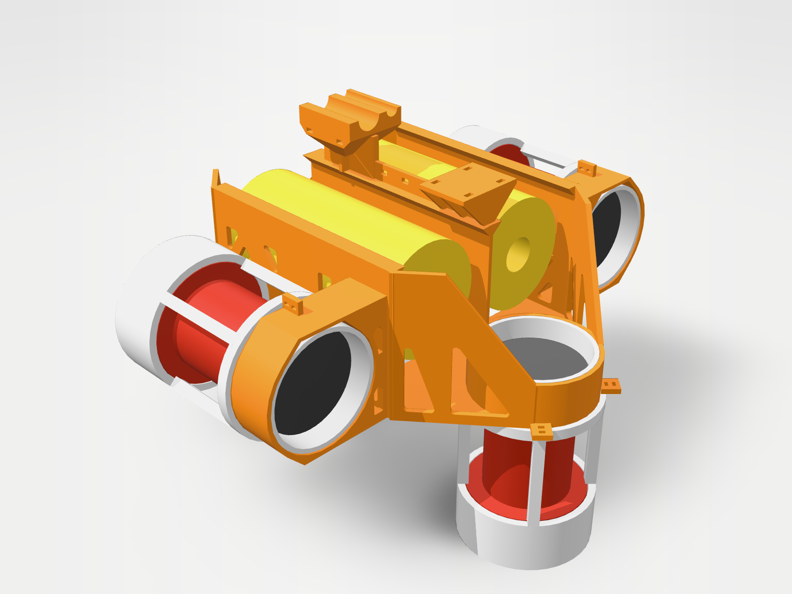

# Aqua Bots ROV v17 "v13 shape": our v13 frame with the floats built in

This design looks like our current robot (v13):
- a flat frame
- a ring at each of the four ends
- angled braces from the middle in to the up/down rings
- triangle-truss windows
- a box cross bar that ends in the two side rings, which look like a stadium from the front

Unlike v16, the pool noodles are **inside** the frame. The middle is a box that holds two noodle pieces. It stands 13 mm above
the rest of the deck, like a low cockpit. Nothing sits on top except the camera shelf, the cable rack and the tether post.

Like v13, it grips each pod by its 64 mm prop duct. It uses the same thrusters (SEAFLO SFBP1-G1100-01, 55 mm props,
"motor caseing v1") and motor numbers: **1 rear-up, 2 front-up, 3 right, 4 left**.

Other designs: **v15** (open frame, on `main`), **v16** (v13 frame with noodles on top, branch `v16-classic`),
**v14** (flooded hull, branch `v14-flooded-hull`).

| | |
|---|---|
| Printed parts | 1 frame, 270 × 291 × 119 mm |
| Filament | PETG 325 g / PLA 330 g, about 7.2 h on a Bambu H2S |
| Hardware | zip ties only (about 14) |
| Floats | 2 × 124 mm of 65 mm pool noodle (123 mm for a PLA frame) |
| Mass | about 2.17 kg; +15 g buoyant at the surface; level |

## Build
1. **Print** `print/petg/rov_v17_PETG.gcode.3mf` or `print/pla/rov_v17_PLA.gcode.3mf`.
   - Settings if you slice it yourself: Bambu H2S, 0.4 nozzle, 0.20 mm Standard, 100 % infill, 3 walls, Textured PEI plate, **no supports**.
   - The printability check passes with no errors; the frame is one solid body.
2. **Noodles:**
   - Cut two 124 mm pieces from a 65 mm noodle.
   - Push one into each side of the box from the top. It squeezes past the 45° lips along the top edges and stays put.
   - Centre each piece **4 mm behind the middle**: it runs from 66 mm behind to 58 mm in front.
   - A zip tie over the top through the windows is optional.
3. **Up/down pods (front and rear):** push them up into the rings from below, prop duct up, until the pod's 75 mm ring
   stops against the frame. Zip-tie each of the two lugs to the cage bar below it.
4. **Side pods:** prop duct forward into the side ring; the body trails behind. Put two zip ties through the fin on top
   of each ring and around the top cage bars.
5. **Wiring:**
   - **Splices:** they go under the noodles, on the bottom deck. Its four big windows drain water and take zip ties.
   - **Tether post (rear):** zip the tether (up to 14 mm) and the camera cable (up to 7 mm) into their grooves, and leave a slack loop down into the box.
   - **Cable rack:** the raised spine between the post and the camera mast has zip holes for the camera cable.
6. **Camera:** goes on the shelf at the front, on top of the mast, and looks forward over the front ring. It has 4 zip-tie slots.

Trim in the pool:
* Sinks: use longer pieces. 1 mm on both pieces adds about 6 g of lift; the box takes up to 136 mm.
* Nose down: slide both pieces forward.
* Nose up: slide them back.

## Why the cross bar is forward of the middle
The side motors trail 90 mm behind their rings. To keep the balance point inside the float box, the cross bar sits 52 mm
forward. It still reads as v13's cross bar, and the noodles end up centred in the box.

## Software: design config "v17"
In the control software, open **SETUP → DESIGN** and choose **v17 v13 shape**. It sets:
* `pitch_mix = 0.25`: the floats sit lower than on v16, so it rights itself more gently. With 0.4 a full tilt stick
  flips it over. With 0.25 a full stick holds 38°.
* `heave_front = 1.0`, `heave_rear = 0.92`: climbs and dives level. Without this it pitches about 7°.
* `surge_pitch = 0.27`: stays level at full forward. Without this it pitches about 40°, because the side motors sit
  below the centre of drag.

## Results (simulation and FEA, not yet pool-tested)
| | v17 | old v13 |
|---|---|---|
| Forward / reverse | 0.74 / 0.62 m/s | 0.80 / 0.67 m/s |
| Up / down | 0.54 / 0.44 m/s | 0.75 / 0.61 m/s |
| Pitch at full forward / while rising | +0.8° / +0.2° (with the design config) | +0.8° / +2.5° |
| Spin, turn radius | 388 °/s, 0.18 m | 403 °/s, 0.23 m |
| Upright from upside down / on its side | 1.9 s / 0.7 s | |
| Centre of buoyancy above centre of gravity | 16 mm (v16: 34 mm) | |

Lifting the robot by the tether, or a 30 N sideways yank on it, leaves at least 11× the strength needed in PETG and 12× in PLA.
The pods, noodles and frame don't overlap. At depth the noodles squash: −15 g at 1 m and −75 g at 3 m, which the up motors easily cover.

**Trade-off against v16:** v17 looks closer to v13, is lighter and prints faster. It rights itself more weakly, so
use the gentler tilt setting.

Assumptions to check: pump motor 300 g, thrust 5 N forward / 3.5 N reverse, camera 35 g. Weigh a pod.

## Files
- `src/params.py`: every dimension (`XR`, `NZ`, `XS`, …)
- `src/rov.py`: the model (`cad run src/rov.py`)
- `STL/`, `3MF/`, `STEP/`: exports
- `print/`: the sliced files
- `analysis/`: simulation (`cad run analysis/sim.py`) and FEA
- `docs/`: pictures
