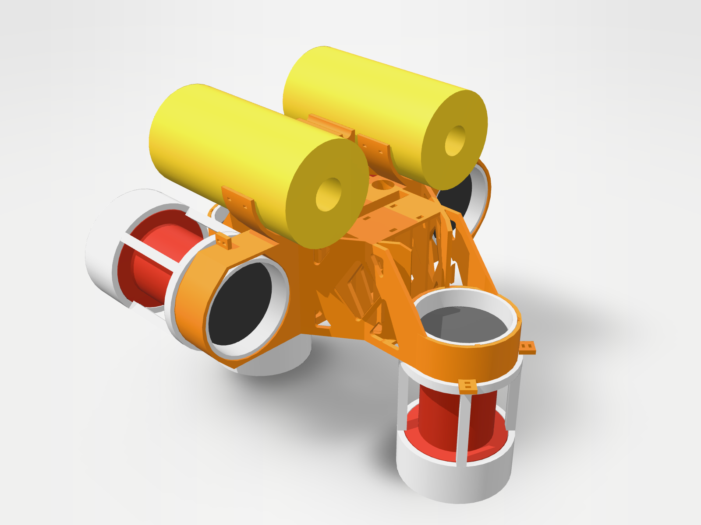

# Aqua Bots ROV v16 "classic": our v13 frame, made to float, right itself and hold the wiring

This branch has the same layout as our current robot (v13). It has:
- a flat frame as tall as a side ring
- two rails between the up/down rings
- diamond braces out to a box cross bar that ends in the two side rings
- triangle-truss windows
- round cable tubes where the rails cross the cross bar

Like v13, it grips each pod by its 64 mm prop duct. It uses the same four thrusters (SEAFLO SFBP1-G1100-01, 55 mm props,
"motor caseing v1") with the same motor numbers: **1 rear-up, 2 front-up, 3 right, 4 left**.

Other designs: **v15** (open frame, on `main`), **v14** (flooded hull, branch `v14-flooded-hull`),
**v17** (the v13 shape with the floats hidden inside, branch `v17-v13-shape`).

| | |
|---|---|
| Printed parts | 1 frame, 260 × 261 × 107 mm |
| Filament | PETG 359 g / PLA 365 g, about 9.3 h on a Bambu H2S |
| Hardware | zip ties only (about 16) |
| Floats | 2 × 126 mm of 65 mm pool noodle (124 mm for a PLA frame) |
| Mass | about 2.2 kg; +15 g buoyant at the surface; level |

## What's different from v13
* **Floats:** two noodle pieces lie in saddles on top of the cross bar. With the floats high and the motors low, it rights itself.
* **Up/down rings sit on the print bed.** The pods push up into them from below (prop duct up) until the pod's 75 mm
  ring stops against the frame. Each ring has two lugs with zip-tie slots; tie each lug to the cage bar below it.
* **Side rings:** prop duct forward, pod body behind. Put two zip ties through the holes in the fin on top of each ring and around the top cage bars.
  The rings have a flat top and a flat foot, like the straight edges on v13, so they print without supports.
* **Wiring:**
  * **Splice tray:** the bottom deck between the rails, with zip-tie slots and drain holes.
  * **Tether post (rear):** grooves for the tether (up to 14 mm) and the camera cable (up to 7 mm). Zip-tie both, and leave a slack loop down to the tray.
  * **Cable tubes:** 15 mm tubes through the cross bar.
  * **Window struts:** use them as zip-tie points for the motor leads.
* **Camera:** a shelf on top at the front, between the noodles. It looks forward over the front ring and has 4 zip-tie slots.

## Print
`print/petg/rov_v16_PETG.gcode.3mf` or `print/pla/rov_v16_PLA.gcode.3mf` are ready to print.
Settings if you slice it yourself:
- Bambu H2S, 0.4 nozzle, 0.20 mm Standard
- 100 % infill, 3 walls
- **Textured PEI** plate
- **no supports**, orientation as exported

The printability check passes with no errors. Every overhang is 45° or a bridge of 26 mm or less.

## Noodles and trim
1. Cut two 126 mm pieces from a 65 mm noodle.
2. Zip-tie them in the saddles, **centred 25 mm behind the cross bar**: each piece runs from 88 mm behind the centre to 38 mm in front.
   They sit that far back because the side motors trail behind the cross bar.
3. Trim in the pool:
   * Sinks: longer noodle pieces (1 mm on both pieces ≈ 6 g).
   * Nose down: slide the noodles forward.
   * Nose up: slide them back.

## Software: design config "v16"
In the control software, open **SETUP → DESIGN** and choose **v16 classic**. It sets:
* `pitch_mix = 0.4`: a full tilt stick holds about 27° instead of flipping the robot over.
* `heave_front = 0.65`, `heave_rear = 1.0`: the side motors make the robot heavier at the back, so the front up/down
  motor works less. Without this it climbs nose-down at about 16°.
* `surge_pitch = 0.2`: when driving forward, adds a little pitch so it stays level. Without this it pitches about 13°.

## Results (simulation and FEA, not yet pool-tested)
| | v16 | old v13 |
|---|---|---|
| Forward / reverse | 0.72 / 0.60 m/s | 0.80 / 0.67 m/s |
| Up / down | 0.55 / 0.45 m/s | 0.75 / 0.61 m/s |
| Pitch at full forward / while rising | +0.1° / +0.1° (with the design config) | +0.8° / +2.5° |
| Spin, turn radius | 393 °/s, 0.13 m | 403 °/s, 0.23 m |
| Upright from upside down / on its side | 1.2 s / 0.4 s | |
| Centre of buoyancy above centre of gravity | 34 mm | |

Lifting the robot by the tether, or a 30 N sideways yank on it, leaves at least 17× the strength needed in PETG and 19× in PLA.
The pods, noodles and frame don't overlap. At depth the noodles squash: −15 g at 1 m and −76 g at 3 m, which the up motors easily cover.

Assumptions to check: pump motor 300 g, thrust 5 N forward / 3.5 N reverse, camera 35 g. Weigh a pod.

## Files
- `src/params.py`: every dimension
- `src/rov.py`: the model (`cad run src/rov.py`)
- `STL/`, `3MF/`, `STEP/`: exports
- `print/`: the sliced files
- `analysis/`: simulation and FEA
- `docs/`: pictures
